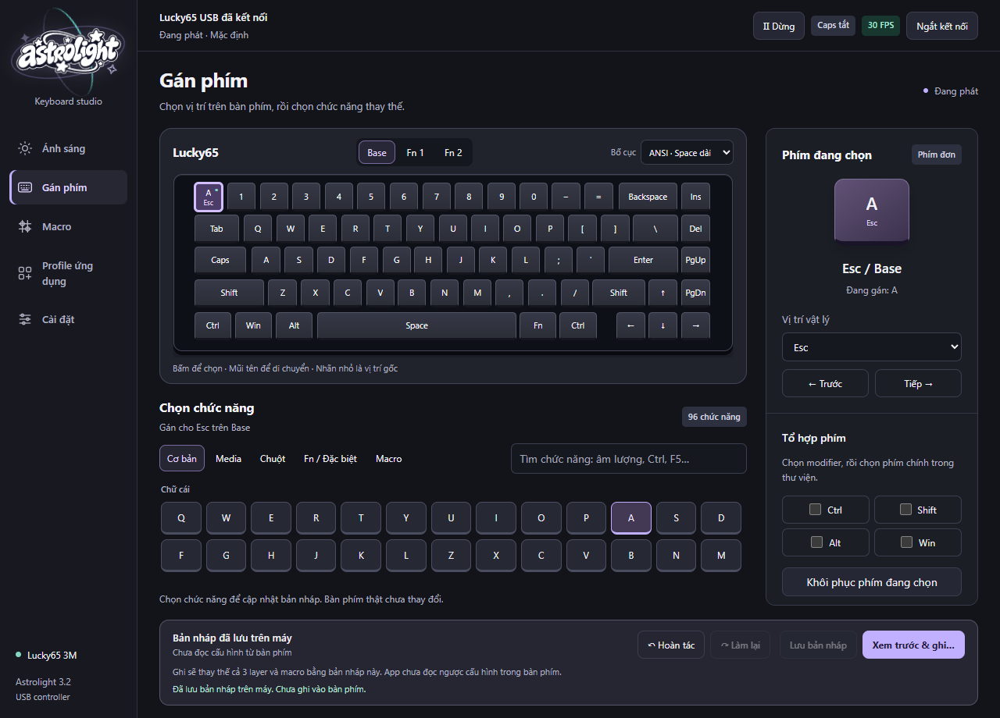
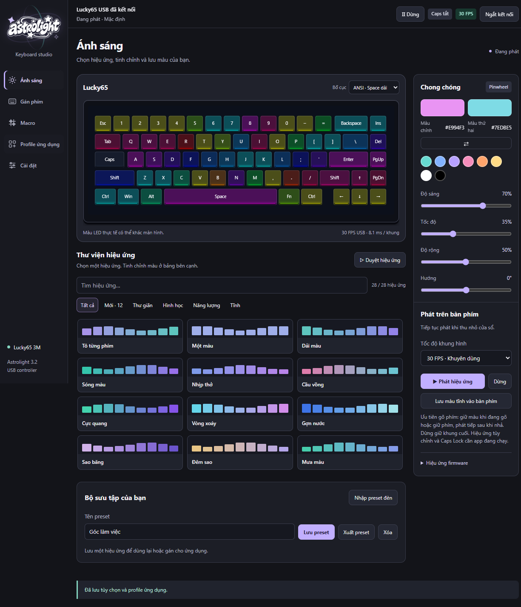

<p align="center">
  
</p>

<h1 align="center">Astrolight</h1>
<p align="center">A lighting and keymap studio for the Lucky65 3M.</p>
<p align="center">
  <a href="https://github.com/validkanaheiuser/astrolight/releases/latest">Download</a> ·
  <a href="CHANGELOG.md">Changelog</a> ·
  <a href="README.vi.md">Tiếng Việt</a> ·
  <a href="https://github.com/validkanaheiuser/astrolight/issues">Report an issue</a>
</p>

Astrolight is an independent, community-built Windows app for the **Lucky65 3M / V1**, written in **Rust and Tauri** with a lightweight HTML/CSS/Canvas interface. It replaces the vendor's configuration app, **not the keyboard firmware**. No firmware flashing or QMK/VIA installation is required.

This started as a personal, AI-assisted project to make the keyboard easier to use: remember the device, offer more lighting options, and provide a clearer remapping interface. It is still a small experimental project; supported features and verification limits are documented below.



## Download and run

1. Open the [latest release](https://github.com/validkanaheiuser/astrolight/releases/latest).
2. Download `Astrolight-3.2.0-windows-x64.exe`, or extract the portable ZIP to a permanent folder.
3. Connect the Lucky65 in **wired USB mode**, close other keyboard RGB controllers, and launch the app.

Astrolight connects automatically, plays a short LED intro, and switches to your lighting profile. Minimize the window to keep custom lighting running; closing the app stops the stream and leaves the last LED frame.

**Requirements:** 64-bit Windows with [Microsoft Edge WebView2 Runtime](https://developer.microsoft.com/en-us/microsoft-edge/webview2/). The app uses the system runtime rather than shipping Electron or its own Chromium distribution. The EXE is about 3.5 MiB; this does not include WebView2 or describe total RAM usage. The downloadable EXE is currently unsigned.

| Hardware / connection | Status |
| --- | --- |
| Lucky65 3M / V1, USB VID `0603`, PID `0351` | Tested in wired mode |
| Bluetooth / 2.4 GHz receiver | Not verified |
| Other Lucky65 revisions or other keyboards | Not claimed to be compatible |

## Features

- **28 lighting modes:** per-key painting, solid/gradient colors, wave, rainbow, aurora, spiral, ripple, meteor, stars, rain, fire, plasma, nebula, ocean, double helix, and more. Adjust colors, brightness, speed, direction and scale; search, filter or cycle through effects.
- **Remapping workspace:** Base, Fn 1 and Fn 2; basic keys, media, mouse functions, modifier combinations and macro assignments. See the physical position and assigned function together, search across categories, and undo/redo draft changes.
- **Macro editor:** up to 10 slots and 84 press/release events per macro, with editable delays and repeat counts. Recording only happens inside the focused recording area.
- **App/game lighting profiles:** switch effects by foreground executable name, with ordered matching rules and a default fallback.
- **Quality-of-life options:** auto-connect, configurable LED intro, animated logo, Caps Lock indicator colors, Windows startup, presets and full-settings import/export.
- **Firmware effects:** hand lighting control back to the keyboard for standalone effects.

<details>
<summary>Lighting workspace</summary>



</details>

## Typing takes priority

Custom lighting defaults to **30 FPS**. Input-priority mode is enabled by default: Astrolight holds the current LED colors while keys are pressed and resumes after a 180 ms quiet interval. This also applies while holding movement keys in a game. The preview and keyboard stream are separate; a high display refresh rate does not require a high USB frame rate.

Version 3.0 could delay key release during sustained 120 FPS RGB traffic. Versions 3.1 and 3.2 reduce USB load, pace complete frames, and avoid catch-up bursts. Legacy 120 FPS profiles are migrated to 30 FPS. Initial device testing improved, but the precise firmware cause and long-term behavior on other units remain unverified. If you encounter repeats or delayed releases, stop custom lighting and include the effect, FPS and input-priority setting in your issue report.

## Remapping: draft versus device

Selecting a keycode edits a **local draft**. **Lưu bản nháp** saves it on the computer. **Xem trước & ghi…** reviews the full configuration before writing all three keymap layers and the draft's macros to the keyboard. Importing a backup does not automatically write the keymap.

Astrolight **does not read back the keymap or macros currently stored in firmware**. A newly opened draft must not be treated as a backup of settings made with another app. The interface is inspired by VIA, but uses the Lucky65 vendor protocol, not QMK/VIA layer semantics.

The encoder matches reference report fixtures byte-for-byte. UI drafting, validation and review flows have been tested; **physical remapping/macro behavior after a device write and persistence after unplugging have not yet been confirmed**. See [validation notes](VALIDATION.md) before relying on those features.

## Build from source

Build on Windows with the Rust **MSVC** toolchain, Visual Studio C++ Build Tools (Desktop development with C++ and a Windows SDK), and WebView2. See [Tauri's Windows prerequisites](https://v2.tauri.app/start/prerequisites/#windows).

```powershell
git clone https://github.com/validkanaheiuser/astrolight.git
cd astrolight
.\Build.ps1
# Output: dist\Astrolight.exe
```

No npm install, frontend bundler or Tauri CLI is required to build the desktop app. The UI is embedded in the executable.

```powershell
# Run in development mode
cargo run --locked --manifest-path src-tauri/Cargo.toml --bin astrolight

# Run Rust tests; no keyboard required
cargo test --locked --manifest-path src-tauri/Cargo.toml --bin astrolight

# Compare JavaScript preview colors with Rust output; requires Node.js
node scripts/check-effects.cjs

# Optional offline UI tests; requires Node.js 20+ and Microsoft Edge
cd scripts
npm ci
npm test
cd ..
```

The UI harness uses fixture data and a temporary loopback HTTP server; it does not access HID or personal app settings. Screenshots and results go to `validation/ui-run/`. The optional Node dependencies are test tooling only.

## Project layout

```text
src-tauri/src/          Rust engine, HID transport, keymaps and Windows integration
src-tauri/fixtures/     Reference HID reports used by encoder tests
ui/                    Interface, SVG branding and Canvas lighting preview
scripts/               Offline UI and effect-parity checks
validation/            UI fixture and selected 3.2 validation results
docs/images/           Screenshots
```

- [Changelog](CHANGELOG.md) — public release notes and development history.
- [Vietnamese user guide](README.vi.md) — detailed controls and behavior.
- [Protocol notes](PROTOCOL-v3.md) / [earlier RGB analysis](PROTOCOL-v1.md).
- [Design guidelines and references](DESIGN-GUIDELINES.md).
- [Testing scope and known limitations](VALIDATION.md).

## Data and privacy

Settings stay in `%APPDATA%\local.astrolight.lucky65`: `settings.json`, `options.json`, `keymap.json` and `presets.json`. Keep the EXE at a stable path when enabling Windows startup; if you move it, disable and re-enable that option.

The UI has no telemetry or remote content. Foreground profile matching reads the executable name, not window contents. The keyboard hook keeps transient pressed-key state and timing for input priority/Caps Lock; it does not store typed text, suppress keys or synthesize keyboard events. Macro recording is an explicit, focused UI operation.

## Contributing

Bug reports and small, focused pull requests are welcome. Include the keyboard revision, connection mode, app version and steps to reproduce. For lighting/input issues, include the effect, FPS and input-priority state. Avoid attaching personal settings without reviewing them first. Protocol changes should include fixture tests or a reproducible device experiment, with hardware verification clearly separated from software-only tests.

## Credits and license

Inspired by [VIA](https://github.com/the-via/app) for keymap interaction and [QMK RGB Matrix](https://docs.qmk.fm/features/rgb_matrix) for lighting ideas. The interface and effect formulas are implemented separately. Astrolight is not affiliated with the keyboard manufacturer, VIA or QMK.

[MIT License](LICENSE). Third-party dependencies retain their respective licenses.
